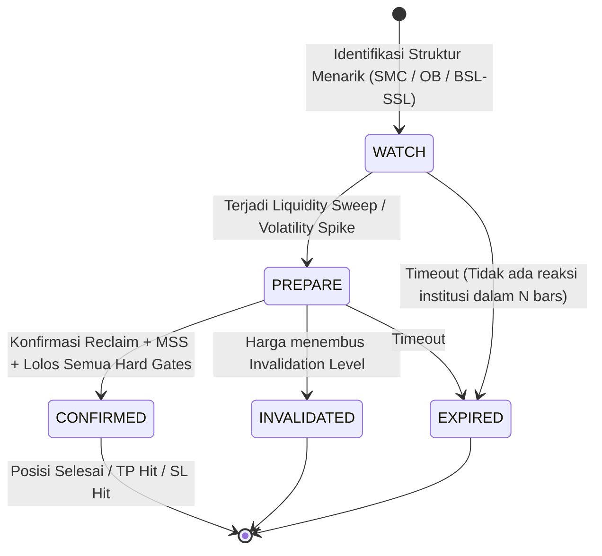

# INSTITUTIONAL TRADING INTELLIGENCE (ITI)
## DOCUMENT 3: TECHNICAL ARCHITECTURE & MATHEMATICAL SPECIFICATIONS (`docs/ITI_ARCHITECTURE.md`)

---

### 1. High-Level Architectural Diagram

```
                                 ┌───────────────────────────────────────────────┐
                                 │           BINANCE UPSTREAM GATEWAY            │
                                 │  - Binance USDⓈ-M Futures REST & WebSocket    │
                                 │  - Optional Spot Comparative Feeds            │
                                 └──────────────────────┬────────────────────────┘
                                                        │
                      ┌─────────────────────────────────┴─────────────────────────────────┐
                      │                                                                   │
           [Diff Depth @ 100ms]                                           [aggTrade & markPrice]
                      │                                                                   │
                      ▼                                                                   ▼
       ┌───────────────────────────────┐                                   ┌───────────────────────────────┐
       │   ITISessionManager (Core)    │                                   │     ITI Ingestion Engine      │
       │  - Active Symbol Registry     │◄──────────────────────────────────┤  - Timestamp Validation       │
       │  - Generation ID Validator    │   Active Symbol Filter (Strict)   │  - Sequence Check (Local Book)│
       │  - Zero-Scanner Enforcement   │                                   │  - Bounded Memory Buffers     │
       └──────────────┬────────────────┘                                   └──────────────┬────────────────┘
                      │                                                                   │
                      └───────────────────────────────┬───────────────────────────────────┘
                                                      │ Validated Active Pair Frames
                                                      ▼
                      ┌───────────────────────────────────────────────────────────────────┐
                      │                7 INSTITUTIONAL ANALYTICAL ENGINES                 │
                      ├───────────────────────────────┬───────────────────────────────────┤
                      │ 1. SMC & Market Structure     │ 5. Footprint & Order Flow (CVD)   │
                      │ 2. Liquidity & BSL/SSL Pools  │ 6. Volume Profile & Anchored VWAP │
                      │ 3. Stop Loss Hunter & Reclaim │ 7. Derivatives (OI / Funding / LS)│
                      │ 4. DOM Microstructure & OBI   │                                   │
                      └───────────────────────────────┬───────────────────────────────────┘
                                                      │ Feature Vectors & Metrics
                                                      ▼
                      ┌───────────────────────────────────────────────────────────────────┐
                      │                     ITI DECISION & RISK ENGINE                    │
                      │  - Hard Gates Evaluation (Spread, Volatility, Stale Data)         │
                      │  - Confluence Direction Scoring (Long Score vs Short Score 0-100) │
                      │  - Signal State Machine (WATCH -> PREPARE -> CONFIRMED)           │
                      │  - Trade Plan Builder (Exact Entry, Invalidation SL, Dynamic TPs) │
                      └───────────────────────────────┬───────────────────────────────────┘
                                                      │ Sub-second Telemetry
                                                      ▼
                      ┌───────────────────────────────────────────────────────────────────┐
                      │                 PRESENTATION & USER WORKSPACE                     │
                      │  - Lightweight Charts (Canvas SMC, SL Corridors, Whale Walls)     │
                      │  - RightSidebar: ITI Intel Tab (Lifecycle, Gates, Strategy Plan)  │
                      │  - Floating Bottom-Left HUD: Real-time Radar & Squeeze Telemetry  │
                      └───────────────────────────────────────────────────────────────────┘
```

---

### 2. Upstream Binance Endpoints & Local Order Book Protocol

Semua endpoint dan stream yang digunakan mematuhi dokumentasi resmi **Binance USDⓈ-M Futures API (fapi)**:

#### 2.1 REST Endpoints (Spesifik Active Symbol)
* **Depth Snapshot**: `GET /fapi/v1/depth?symbol={active_symbol}&limit=1000`
* **Recent Aggregated Trades**: `GET /fapi/v1/aggTrades?symbol={active_symbol}&limit=500`
* **Premium Index / Mark Price & Funding**: `GET /fapi/v1/premiumIndex?symbol={active_symbol}`
* **Open Interest**: `GET /fapi/v1/openInterest?symbol={active_symbol}`
* **Top Trader Long/Short Ratio**: `GET /futures/data/topLongShortPositionRatio?symbol={active_symbol}&period=15m&limit=1`
* **Global Long/Short Account Ratio**: `GET /futures/data/globalLongShortAccountRatio?symbol={active_symbol}&period=15m&limit=1`
* **Taker Long/Short Volume Ratio**: `GET /futures/data/takerlongshortRatio?symbol={active_symbol}&period=15m&limit=1`

#### 2.2 WebSocket Streams (Hanya Untuk Active Symbol)
* **Diff Depth Stream (100ms)**: `<symbol>@depth@100ms`
* **Aggregated Trades Stream**: `<symbol>@aggTrade`
* **Mark Price Stream (1s)**: `<symbol>@markPrice@1s`
* **Liquidation Order Stream**: `!forceOrder@arr` (difilter hanya untuk `o.s == active_symbol`)

#### 2.3 Protokol Sinkronisasi Local Order Book (Sequence Verification)
Untuk mempertahankan buku order L2 lokal yang akurat tanpa celah (*gapless*):
1. Buka koneksi WebSocket ke stream `<symbol>@depth@100ms` dan buffer semua event yang masuk.
2. Ambil snapshot buku order via REST `GET /fapi/v1/depth?symbol={symbol}&limit=1000` yang mengembalikan `lastUpdateId`.
3. Buang semua event buffered di mana update ID terakhir `u < lastUpdateId`.
4. Event pertama yang diproses harus memenuhi:
   $$U \le \text{lastUpdateId} \quad \text{dan} \quad u \ge \text{lastUpdateId}$$
5. Untuk event-event berikutnya, pastikan update ID kontinu:
   $$\text{Event}(k).pu == \text{Event}(k-1).u$$
6. **Deteksi Anomali / Gap**: Jika terjadi sequence jump ($\text{Event}(k).pu \ne \text{Event}(k-1).u$), buffer lokal dianggap korup. Sistem memicu re-snapshot ulang dan menetapkan status sementara `STALE_DATA_SYNCING`.

---

### 3. Formulasi Matematis & Mikrostruktur Pasar

#### 3.1 Microprice & Order Book Imbalance (OBI)
Microprice merefleksikan harga wajar sesaat (*instantaneous fair price*) yang diboboti oleh volume pada level bid dan ask terbaik:

$$P_{\text{micro}} = \frac{Q_{\text{bid}} \cdot P_{\text{ask}} + Q_{\text{ask}} \cdot P_{\text{bid}}}{Q_{\text{bid}} + Q_{\text{ask}}}$$

Order Book Imbalance (OBI) dihitung pada $N$ tingkat kedalaman (default $N=10$):

$$\text{OBI}_N = \frac{\sum_{i=1}^{N} V_{\text{bid}, i} - \sum_{i=1}^{N} V_{\text{ask}, i}}{\sum_{i=1}^{N} V_{\text{bid}, i} + \sum_{i=1}^{N} V_{\text{ask}, i}} \quad \in [-1.0, +1.0]$$

Weighted OBI memberikan bobot eksponensial menurun sesuai jarak dari mid-price:

$$\text{WOBI} = \frac{\sum_{i=1}^{N} w_i \cdot (V_{\text{bid}, i} - V_{\text{ask}, i})}{\sum_{i=1}^{N} w_i \cdot (V_{\text{bid}, i} + V_{\text{ask}, i})}, \quad \text{di mana } w_i = e^{-\lambda \cdot (i - 1)}$$

#### 3.2 Cumulative Volume Delta (CVD) & Footprint Aggression
Berdasarkan payload `aggTrade` Binance (`m` = true jika buyer maker / penjualan agresif):
* Jika $m = \text{false}$: Taker Buy Volume ($V_{\text{buy}} = q$)
* Jika $m = \text{true}$: Taker Sell Volume ($V_{\text{sell}} = q$)

$$\Delta_t = V_{\text{buy}, t} - V_{\text{sell}, t}$$

$$\text{CVD}_T = \sum_{t=0}^{T} \Delta_t$$

**CVD Absorption Divergence**:
* *Bullish Absorption*: Harga membuat New Low ($P_{\text{low}, t} < P_{\text{low}, t-1}$), namun $\text{CVD}_t > \text{CVD}_{t-1}$ (Volume jual besar diserap oleh limit bid institusi).
* *Bearish Exhaustion*: Harga membuat New High ($P_{\text{high}, t} > P_{\text{high}, t-1}$), namun $\text{CVD}_t < \text{CVD}_{t-1}$ (Kurangnya partisipasi taker buy pada puncak harga).

#### 3.3 Pemodelan Matematis Titik Forced Stop Loss (Binance MMR)
Posisi leverage tinggi (50x, 25x) memiliki titik likuidasi deterministik berdasarkan persentase Maintenance Margin Requirement ($\text{MMR} \approx 0.4\% - 0.5\%$):

$$\text{Short SL}_{50x} = P_{\text{entry, short}} \times \left(1 + \frac{1}{\text{Leverage}} - \text{MMR}\right) \approx P_{\text{entry}} \times 1.0195$$

$$\text{Long SL}_{50x} = P_{\text{entry, long}} \times \left(1 - \frac{1}{\text{Leverage}} + \text{MMR}\right) \approx P_{\text{entry}} \times 0.9805$$

Level-level ini diproyeksikan secara real-time pada Canvas chart sebagai koridor magnet likuidasi.

---

### 4. State Machine & Decision Engine

#### 4.1 Transisi State Siklus Sinyal



#### 4.2 Matriks Bobot Skor Confluence (Total 100 Poin)
* **Market Structure & Displacement (SMC)**: Bobot 25%
* **Order Flow & CVD Divergence / Absorption**: Bobot 20%
* **Order Book Imbalance (DOM Depth & Microprice)**: Bobot 20%
* **Liquidity Sweep / Stop Loss Magnet Trap**: Bobot 15%
* **Derivatives (OI Delta & Top Trader Bias)**: Bobot 10%
* **Anchored VWAP Alignment**: Bobot 10%

Ambang batas status `CONFIRMED`: Skor $\ge 75$ Poin **DAN** seluruh Hard Gates berstatus `PASS`.

---

### 5. Alokasi Memori & Efisiensi VPS 1GB RAM

Untuk mencegah kebocoran memori (*memory leak*) pada VPS Ubuntu dengan RAM 1GB:
1. **Bounded Deque Structures**:
   - `aggTrades` buffer dibatasi maksimum 500 transaksi per symbol.
   - Candlestick in-memory dibatasi maksimum 1.200 bar per timeframe.
   - Local order book dibatasi maksimum 50 level bid dan 50 level ask terdalam.
2. **Explicit Garbage Collection pada Symbol Switch**:
   - Saat user berpindah pair, method `cleanup_pair_session()` memanggil pembatalan semua background task pair lama dan melepaskan referensi objek agar segera dibersihkan oleh garbage collector.
3. **No Background Ingestion untuk Non-Active Pairs**:
   - Sesuai instruksi mutlak, backend tidak pernah membuka koneksi WebSocket atau polling REST untuk pair selain `active_symbol`.
