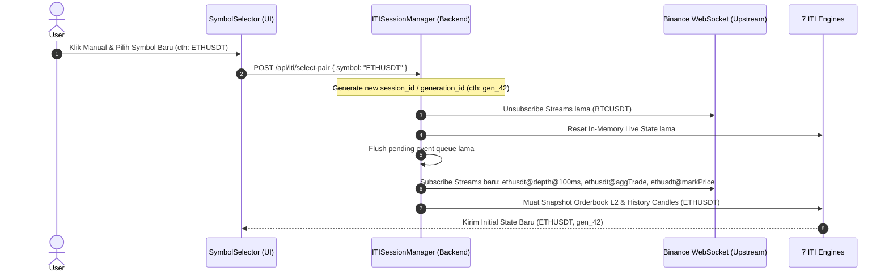

# INSTITUTIONAL TRADING INTELLIGENCE (ITI)
## DOCUMENT 2: INTEGRATION PLAN (`docs/ITI_INTEGRATION_PLAN.md`)

---

### 1. Prinsip Integrasi & Non-Destructive Engineering

Integrasi **Institutional Trading Intelligence (ITI)** ke dalam platform web eksisting dilakukan dengan mematuhi prinsip-prinsip mutlak:
1. **Zero-Destructive Policy**: Tidak ada penghapusan kode, modifikasi skema database file eksisting, atau perombakan framework.
2. **Kepatuhan Tunggal Active-Pair**: ITI hanya aktif pada satu pasangan mata uang (`active_symbol`) yang dipilih manual oleh pengguna melalui `SymbolSelector.tsx`. Tidak ada background polling atau scanning multi-pair yang menghabiskan memori dan rate limit.
3. **Kompatibilitas Komponen**: Menggunakan kembali seluruh komponen visual yang sudah teruji (`LightweightChart.tsx`, `RightSidebar.tsx`, modal, font mono, design tokens).
4. **Data Integrity & Stale Detection**: Jika upstream Binance terputus atau paket data melompati sequence ID, ITI menampilkan status `STALE / UNAVAILABLE` secara eksplisit dan menolak membuat sinyal/konfirmasi palsu (*no fake confirmations*).

---

### 2. Lokasi Integrasi Pada Website Eksisting

```
┌────────────────────────────────────────────────────────────────────────────────────────┐
│ TOP NAVBAR / HEADER: Pair Selector (Manual) | Active Market: USDⓈ-M Futures | ITI HUD  │
├───────────────┬────────────────────────────────────────────────────────┬───────────────┤
│ LEFT SIDEBAR: │ MAIN CHART WORKSPACE (LightweightChart.tsx):           │ RIGHT SIDEBAR:│
│               │ - Candlestick Multi-Timeframe (1m, 5m, 15m, 1h, 4h)    │ Tabs:         │
│ • Symbol Info │ - Canvas Overlay: ITI SMC, BSL/SSL, SL Hunter, AVWAP   │ • [iti] ⭐    │
│ • Drawing     │ - Real-time Stop Loss Squeeze Corridors                │ • Index       │
│ • TF Selector │ - Whale Fortress Wall Markers                          │ • Setup Radar │
│ • Mode / Tool │                                                        │ • Positions   │
│ • Matrix DOM  ├────────────────────────────────────────────────────────┤ • Calculator  │
│               │ BOTTOM DOCK: ITI Trade Plan / DOM Depth Matrix         │ • Watchlist   │
│               │ (Execution Manual v1: WATCH | PREPARE | CONFIRMED)     │ • Journal     │
└───────────────┴────────────────────────────────────────────────────────┴───────────────┘
```

#### 2.1 Lokasi UI (Frontend)
1. **Right Sidebar Workspace (`RightSidebar.tsx`)**:
   - Menambahkan tab khusus berprioritas tinggi: `iti` (diberi ikon `ShieldCheck` atau `Radar` dengan label **"ITI Intel"**).
   - Panel ini menampilkan:
     - **Status Siklus Sinyal**: `WATCH` $\rightarrow$ `PREPARE` $\rightarrow$ `CONFIRMED` $\rightarrow$ `INVALIDATED` / `EXPIRED`.
     - **Skor Confluence Arah**: Long Score vs Short Score (0 - 100%).
     - **Hard Gates Checklist**: Volatility ATR, Spread Check, Data Freshness, News/Spike Filter.
     - **Trade Plan Eksekusi**: Rekomendasi Titik Entry Optimal, Invalidation Stop Loss, Multi-Target TP (TP1, TP2, TP3), dan Risk/Reward rasio.
2. **Chart Overlay Layer (`LightweightChart.tsx`)**:
   - Didaftarkan di bawah kelompok menu **🏛️ Indikator Institusional**:
     - `itiSmc`: Order Blocks, Break of Structure, CHoCH, Liquidity Inducement.
     - `itiLiquidity`: BSL (Buy-Side Liquidity), SSL (Sell-Side Liquidity), Equal Highs/Lows.
     - `itiSlHunter`: Titik sapuan likuidasi dan area False Breakout / Reclaim.
     - `itiVwapBands`: Anchored VWAP dengan pita standar deviasi institusi $\pm 1\sigma, \pm 2\sigma$.
3. **Pojok Bawah Kiri (Floating HUD)**:
   - Terintegrasi dengan widget **Market X-Ray / ITI Telemetry** yang telah diposisikan di sudut kiri bawah, menampilkan status mikrostruktur terkini secara non-intrusif.

#### 2.2 Lokasi Backend
1. **Modul Terisolasi (`backend/app/iti/`)**:
   - Seluruh logika ITI diletakkan dalam folder terpisah agar tidak mengganggu logika engine lama.
   - Terdiri dari:
     - `iti_session_manager.py`: Manajemen sesi symbol aktif, generation token, pembersihan queue.
     - `iti_ingestion.py`: Ingestion diff depth, aggregate trades, mark price, OI, funding.
     - `iti_engines/`: 7 sub-engine khusus per disiplin institusional.
     - `iti_decision_engine.py`: Penghitung skor akhir, evaluasi hard gates, dan state machine.
2. **API Routes (`backend/app/api/iti_routes.py`)**:
   - Ditautkan ke FastAPI `app.include_router(iti_router)` pada `backend/app/main.py`.

---

### 3. Protokol Pemilihan Pair & Manajemen Sesi (`iti_session_manager.py`)

Untuk mematuhi mandat **HANYA BEKERJA PADA SATU PAIR AKTIF YANG DIPILIH MANUAL**:



1. **Generation ID Tagging**: Setiap pergantian pair menaikkan `generation_id` (+1). Semua paket WebSocket atau async task yang tiba dengan `generation_id` lama langsung diabaikan (*discarded*).
2. **Data Retention**: Histori analisis teknikal per symbol tetap disimpan di memory cache lokal agar ketika user kembali ke pair lama, histori tidak hilang.
3. **Strict Single Subscription**: Tidak pernah ada koneksi WebSocket background yang berjalan untuk pair yang tidak aktif.

---

### 4. Rincian 7 Engine Analisis Institusional

| Nama Engine | File Modul | Masukan Data | Output Analitik |
| :--- | :--- | :--- | :--- |
| **1. SMC Engine** | `iti_smc_engine.py` | Klines MTF (1m, 5m, 15m, 1h, 4h) | Swing structure, BOS, CHoCH, Market Structure Shift (MSS), Order Blocks (OB), Breaker Block, Fair Value Gaps (FVG/IFVG), Premium/Discount zone, Displacement magnitude. |
| **2. Liquidity Engine** | `iti_liquidity_engine.py` | High/Low series, Session times | Buy-Side Liquidity (BSL), Sell-Side Liquidity (SSL), Equal Highs/Lows (EQH/EQL), Previous Day/Week High & Low (PDH/PDL, PWH/PWL), Liquidity Inducement zones. |
| **3. SL Hunter Engine** | `iti_sl_hunter_engine.py` | AggTrades, Klines wicks, Delta | Deteksi sapuan stop loss (*wick sweep*), candle reclaim, fake breakout, volume surge pada level kunci, CVD absorption proxy, sweep-to-MSS trigger. |
| **4. DOM Microstructure** | `iti_dom_engine.py` | L2 Diff Depth (100ms), Depth Snapshot | Local Order Book maintained by update ID, Order Book Imbalance (OBI), Weighted OBI, microprice calculation, Bid/Ask wall persistence, pulling/replenishment detection, Iceberg warning. |
| **5. Footprint / Orderflow** | `iti_footprint_engine.py` | AggTrades (Buyer/Seller maker flag) | Aggressor volume classification, per-bar delta, Cumulative Volume Delta (CVD), stacked imbalance baris harga, volume exhaustion, CVD divergence. |
| **6. Volume Profile & AVWAP**| `iti_volume_profile_engine.py`| Trades, Klines | Value Area High (VAH), Value Area Low (VAL), Point of Control (POC), High/Low Volume Nodes (HVN/LVN), Session Anchored VWAP dengan pita $\pm 1\sigma, \pm 2\sigma$. |
| **7. Derivatives & Sentiment**| `iti_derivatives_engine.py` | Open Interest, Funding Rate, Ratios | Open Interest delta, Funding Rate z-score, Top Trader Long/Short ratio, Global Account L/S ratio, Taker Buy/Sell volume ratio, Real-time liquidation telemetry. |

---

### 5. Decision Engine, Hard Gates & Lifecycle Sinyal

#### 5.1 Siklus Hidup Sinyal (*Signal Lifecycle State Machine*)
Sistem tidak mengeluarkan sinyal statis, melainkan memantau status secara dinamis:
* **`WATCH`**: Struktur pasar menarik (misal harga mendekati area BSL/SSL atau OB), namun belum ada aksi dari smart money.
* **`PREPARE`**: Terjadi sapuan likuiditas (*liquidity sweep*) atau imbalance ekstrem; algoritma bersiap menunggu konfirmasi reclaim/MSS.
* **`CONFIRMED`**: Terjadi konfirmasi valid (MSS terkonfirmasi + delta absorption + lolos semua *Hard Gates*). Rencana trading lengkap siap dieksekusi.
* **`INVALIDATED`**: Harga menembus level pembatalan sebelum setup terkonfirmasi (struktur patah).
* **`EXPIRED`**: Waktu tunggu habis tanpa terjadi reaksi volume institusional.

#### 5.2 Hard Gates (Filter Wajib Sebelum `CONFIRMED`)
Sinyal **TIDAK AKAN PERNAH** berubah menjadi `CONFIRMED` jika salah satu dari gerbang ini gagal:
1. **Spread Gate**: Spread bid-ask saat ini $\le 0.05\%$ (mencegah slippage tinggi).
2. **Data Freshness Gate**: Delay data orderbook dan trades $<1.5$ detik. Jika data stale $\rightarrow$ status `STALE_DATA_LOCK`.
3. **Volatility Gate**: ATR tidak berada dalam fase anomali ekstrem yang memicu slippage tak terkendali.
4. **Counter-Trend Whale Gate**: Arah setup tidak boleh melawan *Whale Fortress Wall* masif yang berjarak kurang dari $0.3\%$.

---

### 6. Rencana Tahapan Pelaksanaan (*Rollout Phases*)

* **Phase 0 (Selesai)**: Audit sistem, pembuatan dokumentasi arsitektur, verifikasi dependensi dan VPS DNS bypass.
* **Phase 1**: Pembuatan modul backend `backend/app/iti/` mencakup `iti_session_manager.py` dan `iti_ingestion.py` (penanganan single active pair & WebSocket upstream Binance).
* **Phase 2**: Implementasi 7 engine institusional analitik dengan kalkulasi matematis berbasis data riil.
* **Phase 3**: Pembuatan `iti_decision_engine.py`, Hard Gates validator, dan kalkulator position sizing berbasis risiko nominal.
* **Phase 4**: Integrasi frontend: Pembuatan tab `iti` di `RightSidebar.tsx`, penambahan layer ITI di `LightweightChart.tsx`, dan penyesuaian endpoint API.
* **Phase 5**: Pengujian unit/integrasi, verifikasi live VPS Indonesia, dan sinkronisasi GitHub.
